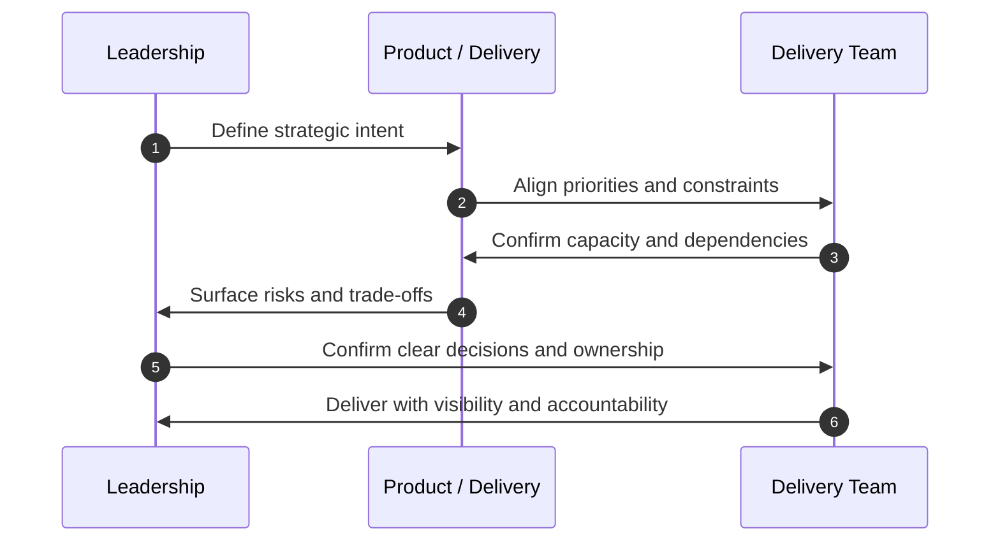

  <h1 style="margin: 0 0 10px 0; color: #7dd3fc; font-size: 30px; letter-spacing: 0.12em; font-weight: 700; text-transform: uppercase;">
    Deven Kashyap
  </h1>

  

    DELIVERY LEADERSHIP & EXECUTION
  

  

    Strategy into execution. Clarity before commitment.
  

---

## Overview

I help teams turn strategy into execution by creating clarity around priorities, ownership, dependencies, and measurable outcomes. My focus is not simply moving work faster — it is building the conditions for reliable delivery, better decisions, and sustainable execution.

---

## What I do

### Strategic clarity
I work with teams and leaders to turn ambiguity into focused execution plans. This includes alignment on outcomes, decision rights, sequencing, and risk-aware prioritization.

### Team enablement
I build operating rhythms that help teams stay aligned without losing momentum. That includes coaching, decision frameworks, and practical ways to improve accountability and delivery quality.

### Delivery visibility
Leadership needs actionable insight, not vanity reporting. I help teams surface blockers early, connect delivery progress to business outcomes, and make trade-offs explicit.

### Sustainable execution
The goal is not just throughput. It is durable execution: a healthy pace, visible risk, clear ownership, and a team that can deliver repeatably without chaos.

---

## How I work

---

## Leadership practice stack

| Capability | Focus |
| --- | --- |
| Strategic planning | Priorities, sequencing, dependency management |
| Team enablement | Coaching, accountability, healthier execution habits |
| Delivery governance | Decision-making, risk visibility, escalation paths |
| Outcome measurement | Clarity on value, progress, and success criteria |

---

## Typical outcomes

- Clearer priorities across teams and stakeholders
- Better ownership, accountability, and decision speed
- Visible risks before they become delivery issues
- More predictable execution with sustainable pace
- Stronger alignment between business intent and delivery reality

---

## Open to

I work with leaders and teams that need stronger delivery discipline, sharper execution clarity, and more confident decision-making.

- Delivery leadership
- Team operating model design
- Strategic alignment and planning
- Execution governance and risk visibility
- Leadership coaching and enablement

---

  Execution with clarity. Delivery with visibility.

