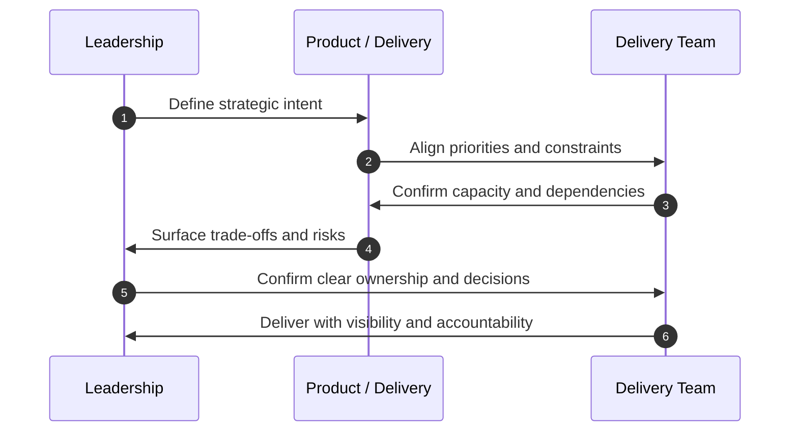

  <h1 style="margin: 0 0 10px 0; color: #7dd3fc; font-size: 30px; letter-spacing: 0.12em; font-weight: 700; text-transform: uppercase;">
    Deven Kashyap
  </h1>

  

    DELIVERY LEADERSHIP & EXECUTION
  

  

    Strategy into execution. Clarity before commitment.
  

---

## Overview

I help teams turn strategic intent into reliable execution by creating alignment around priorities, ownership, dependencies, and measurable outcomes. My work is centered on improving decision quality, reducing delivery friction, and building sustainable execution rhythms that leaders and teams can trust.

---

## What I help teams do

### Strategic clarity
I turn ambiguity into focus by aligning teams around outcomes, decision rights, sequencing, and practical trade-offs.

### Team enablement
I strengthen operating rhythms so teams can execute with better accountability, clearer communication, and healthier momentum.

### Delivery visibility
I help leaders see real progress, identify risks early, and make informed decisions without relying on noisy or superficial reporting.

### Sustainable execution
I build delivery systems that are not just fast, but durable — with clear ownership, visible blockers, and repeatable performance.

---

## How I work

---

## Leadership practice stack

| Capability | Focus |
| --- | --- |
| Strategic planning | Priorities, sequencing, dependency management |
| Team enablement | Coaching, accountability, operating rhythms |
| Delivery governance | Decision-making, escalation paths, risk visibility |
| Outcome measurement | Success criteria, business value, progress tracking |

---

## Typical outcomes

- Clearer priorities across teams and stakeholders
- Better ownership, decision speed, and accountability
- Earlier visibility into risks and dependencies
- More predictable execution with sustainable pace
- Stronger alignment between business intent and delivery reality

---

## Open to

I work with leaders and teams that need sharper delivery discipline, clearer execution paths, and stronger operational confidence.

- Delivery leadership
- Team operating model design
- Strategic alignment and planning
- Execution governance and risk visibility
- Leadership coaching and enablement

---

  Execution with clarity. Delivery with visibility.

